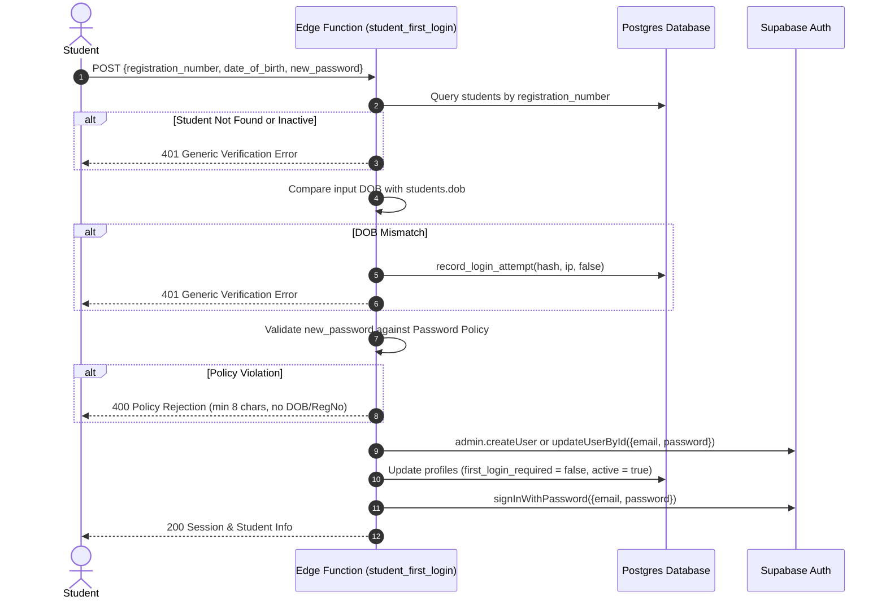

# MIPS ERP - Accounts, Authentication & Security Runbook

## 1. Executive Summary & Security Principles

This runbook documents the accounts, authentication, and security architecture for MIPS ERP following the migration to Supabase Cloud as the single master database.

### Core Architectural Decisions
1. **Cloud Master**: Supabase Postgres is the single source of truth for all operational data.
2. **Role Hierarchy**:
   - `admin`: Full administrative control across all records and security operations. Supports multiple administrators.
   - `teacher`: Attendance management for assigned courses, batches, and subjects only.
   - `student`: Read-only access to their own academic marks, fee ledgers, receipts, and attendance.
3. **Strict Zero-Trust Identity**:
   - **No Self-Registration**: Direct client signups are disabled at the Supabase Auth layer (`enable_signup = false`).
   - **No Email Password Recovery**: Outbound password reset emails are completely disabled to prevent phishing and unauthorized mailbox takeover.
   - **Account Lockout**: After 5 failed login attempts, accounts are locked with the mandatory message:
     > *"Too many failed attempts. Please contact the college office to reset your password."*
   - **Anti-Enumeration Defense**: Failed logins for non-existent identifiers return the exact same generic error as invalid passwords for valid users:
     > *"Register number or password is incorrect."*
   - **CAPTCHA Enforcement**: From the 3rd failed attempt in a sliding window, a Cloudflare Turnstile token is strictly required.
   - **Synthetic Email Addresses**: Non-admin users are assigned RFC 2606 synthetic email addresses that never receive mail:
     - Students: `{registration_number lowercase}@students.mips.invalid`
     - Teachers: `{username lowercase}@teachers.mips.invalid`
     - Administrators: Real institutional email addresses.
   - **Service Key Isolation**: The elevated `SUPABASE_SERVICE_ROLE_KEY` resides **exclusively** in Edge Function server secrets and offline administrative scripts. It is never embedded into Flutter, React client builds, or version control.

---

## 2. Authentication Lifecycle & Workflows

### 2.1 Student Portal Onboarding (First Login)


### 2.2 Teacher Account Provisioning & Activation
1. **Creation**: Admin invokes `create_teacher` Edge Function.
2. **Temporary Password**: The server generates a high-entropy 12-character temporary password returned **once** to the admin.
3. **First Login**: Teacher logs in with `username` and temporary password.
4. **Mandatory Password Change**: Because `profiles.must_change_password = true`, the client restricts the teacher until they call `set_password` with a permanent password meeting all policy constraints.

### 2.3 Administrative Password Resets
Only active administrators can trigger password resets via `reset_password`:
- **For Teachers**: Generates a new temporary password (returned once in the response); sets `must_change_password = true`; revokes existing sessions.
- **For Students**: Sets `first_login_required = true`; scrambles existing auth credentials with a random cryptographic secret; revokes all sessions. The student is redirected to complete Date of Birth verification on their next portal visit.

### 2.4 Administrative Account Unlock
If an account is locked out after 5 failures:
- The administrator invokes `unlock_account({ user_id })`.
- The database clears `locked_at = NULL` and resets `failed_attempts = 0`.
- The action is logged to `audit_log` with the administrator's UUID.

### 2.5 Teacher Deactivation Lifecycle
When an admin deactivates a teacher via `set_teacher_active({ teacher_id, active: false, reassign_to? })`:
1. The teacher's auth account is banned (`ban_duration: '876000h'`) and active sessions are revoked immediately.
2. `profiles.active` is set to `false`.
3. Historical attendance records and previously submitted attendance sessions permanently retain the teacher's `marked_by` audit link.
4. The teacher's sessions are immediately revoked and they lose attendance marking and portal access immediately.

---

## 3. Password Policy Engine

The password policy is centrally enforced by `supabase/functions/_shared/password-policy.ts`:

| Rule | Requirement | Validation Behavior |
|---|---|---|
| **Minimum Length** | $\ge 8$ characters | Rejects strings with length $< 8$. |
| **Username Exclusion** | Must not match or contain username | Case-insensitive substring check. |
| **Registration Number Exclusion** | Must not match or contain registration number | Case-insensitive substring check. |
| **Date of Birth Exclusion** | Must not match or contain Date of Birth | Checks raw date, digits-only (`YYYYMMDD`), and localized (`DDMMYYYY`). |
| **Dictionary Blacklist** | Rejects common weak passwords | Checks against blacklisted words (`password`, `12345678`, `admin123`, `mips1234`, etc.). |

---

## 4. Edge Functions Reference

All Edge Functions are located under [`supabase/functions/`](file:///E:/mips_erp/supabase/functions):

| Function | Route | Auth / Role Requirement | Description |
|---|---|---|---|
| **`login`** | `/functions/v1/login` | Public | Server-side wrapper for `signInWithPassword`. Normalizes identifiers, enforces sliding-window failures, requires Turnstile CAPTCHA on 3rd failure, and triggers lockout on 5th failure. |
| **`student_first_login`** | `/functions/v1/student-first-login` | Public | Validates student DOB against database, initializes auth user, sets password, and logs student in. |
| **`set_password`** | `/functions/v1/set-password` | Authenticated | Allows the active user to set a permanent password, clearing `must_change_password` and revoking other active sessions. |
| **`create_teacher`** | `/functions/v1/create-teacher` | Admin (MFA) | Provisions teacher in Auth and `teachers` table with open faculty access across all primary course batches (no batch assignments). Returns temporary password once. |
| **`update_teacher`** | `/functions/v1/update-teacher` | Admin (MFA) | Edits teacher contact details, updates username, and synchronizes synthetic auth email. |
| **`set_teacher_active`** | `/functions/v1/set-teacher-active` | Admin (MFA) | Deactivates teacher (bans auth user, revokes active sessions immediately) or reactivates them. |
| **`reset_password`** | `/functions/v1/reset-password` | Admin (MFA) | Resets teacher (one-time temp password) or student (`first_login_required` + DOB trigger). |
| **`unlock_account`** | `/functions/v1/unlock-account` | Admin (MFA) | Clears failed attempt counters and lockout timestamp. |

---

## 5. Operations & CLI Tooling

### 5.1 Bootstrapping Administrators
To provision the first administrator account:
```bash
npx tsx scripts/create_admin.ts --email=admin@example.com --name="Principal"
```
- Must use a real institutional email (rejects `.invalid` domains).
- Prints a 16-character temporary password once to `stdout`.
- Administrator is forced to change their password upon first login.

### 5.2 Executing Automated Security Tests
Run the TypeScript security test suite:
```bash
npm test
# or
npx tsx scripts/test_auth_suite.ts
```
Covers:
- Password policy governance
- Crypto normalization and SHA-256 digests
- CORS origin restriction
- Turnstile CAPTCHA validation
- Exact anti-enumeration error strings

### 5.3 Database Auth SQL Verification
In the Supabase SQL editor or via psql, execute the database test scripts:
```sql
-- 1. Anti-enumeration and lockout threshold tests
\i supabase/tests/auth_db_tests.sql

-- 2. End-to-end auth flow, MFA, and teacher lifecycle tests
\i supabase/tests/auth_flow_tests.sql
```

---

## 6. Deployment & Environment Configuration

### Edge Function Deployment Commands
```bash
# Set secrets in Supabase project
supabase secrets set ALLOWED_ORIGINS="https://admin.mips.edu,https://portal.mips.edu"
supabase secrets set CLOUDFLARE_TURNSTILE_SECRET_KEY="0x4AAAAAA..."

# Deploy Edge Functions
supabase functions deploy login --no-verify-jwt
supabase functions deploy student-first-login --no-verify-jwt
supabase functions deploy set-password
supabase functions deploy create-teacher
supabase functions deploy update-teacher
supabase functions deploy set-teacher-active
supabase functions deploy reset-password
supabase functions deploy unlock-account
```

### Production Security Checklist
- [x] Client signups disabled in `config.toml` (`enable_signup = false`).
- [x] Email delivery disabled for confirmation, recovery, and invite templates.
- [x] Service-role key excluded from repository and client binaries.
- [x] Lockout at 5 failed attempts enforced across real and unknown identifiers.
- [x] Turnstile CAPTCHA required after 3 failures.
- [x] Admin MFA (`is_admin()` requires `aal2`) configurable via `settings.require_admin_mfa`.
