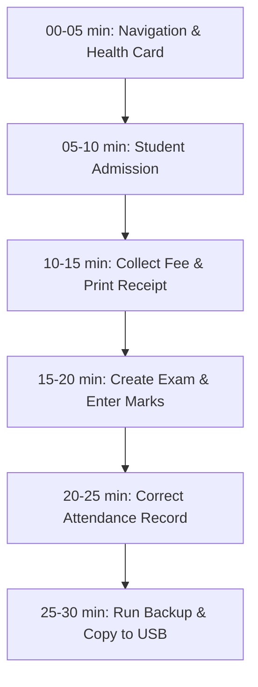
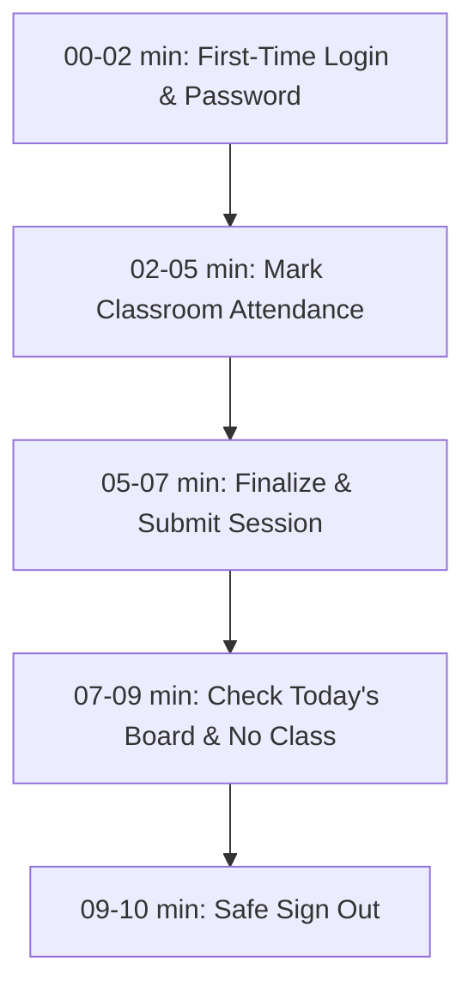
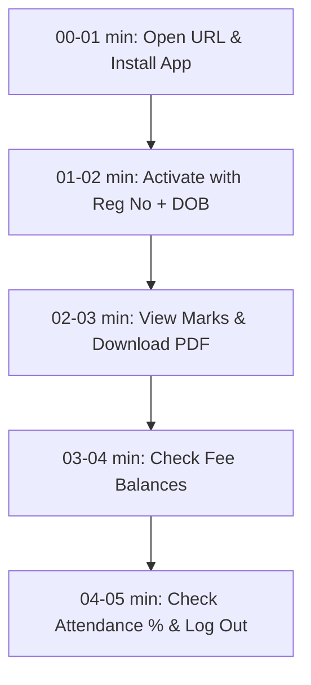

# MIPS ERP — Institutional Training & Onboarding Checklists

> **Document Type**: Hands-on Practical Training Plans  
> **Audience**: Administrative Staff, Faculty Members, Enrolled Students  
> **Format**: Time-boxed step-by-step guided practice  

---

## Part 1: 30-Minute Practice Plan for Administrators

**Goal**: Train a college administrative officer, clerk, or accountant to handle daily student admissions, fee collections, exam publishing, attendance corrections, and offline backups.

### Module 1: Dashboard Navigation & System Health (00–05 min)
- [ ] Launch `mips_erp.exe` on the office computer and sign in with `admin` credentials.
- [ ] Observe the top KPI metric cards (Active Students, Total Collections, Pending Balances).
- [ ] Review the **System Health & Offline Backup** card on the right panel. Verify the backup timestamp and confirm it shows green status.
- [ ] Review **Today's Attendance Board** in the center panel. Note the Morning and Evening status chips for each primary batch.

### Module 2: Admit a Dummy Student (05–10 min)
- [ ] Click **Students** > **+ New Admission**.
- [ ] Enter a practice student:
  - Name: `Practice Student One`
  - DOB: `2004-06-15`
  - Gender: `Male`
  - Phone: `9876543210`
  - Course: `Diploma in Medical Laboratory Technology (DMLT)`
  - Batch: Select active batch.
- [ ] Click **Complete Admission**.
- [ ] Open the student's profile and verify that an automated Fee Ledger has been generated.

### Module 3: Collect Fee Payment & Print Receipt (10–15 min)
- [ ] On the student profile, click the **Fees** tab > Click **Collect Payment**.
- [ ] Enter Amount: `₹10,000`.
- [ ] Select Payment Mode: `UPI / GooglePay`.
- [ ] Enter Remarks: `Test practice collection #01`.
- [ ] Click **Confirm & Process Payment**.
- [ ] Observe that the payment allocated to the oldest installment (FIFO).
- [ ] Click **Print Receipt** > Preview both **Thermal Slip (80mm)** and **A4 College Official Receipt**.

### Module 4: Create Exam, Enter Marks & Publish Online (15–20 min)
- [ ] Navigate to **Examinations** > Click **Create Exam**.
- [ ] Title: `Practice Internal Assessment 1`.
- [ ] Select Course: `DMLT` > Select Batch.
- [ ] Observe that all curriculum subjects auto-populated with Max Marks (100) and Pass Marks (40). Click **Save Exam**.
- [ ] Click **Enter Marks** on the exam card.
- [ ] In the spreadsheet, enter marks for 2 students (e.g., `85` and `35`). Observe the green **PASS** and red **FAIL** tags.
- [ ] Click **Save All Marks**.
- [ ] On the exam dashboard, click **Publish Online**. Confirm the badge changes to green: **Published**.

### Module 5: Review Attendance & Issue an Administrative Correction (20–25 min)
- [ ] Navigate to **Attendance Management** > **Session Review & Corrections**.
- [ ] Filter by today's date. Click **Review & Correct** on any submitted session.
- [ ] Select a student whose attendance was marked `Absent` and change to `Present`.
- [ ] Enter Mandatory Audit Reason: `"Student submitted approved medical certificate #104"`.
- [ ] Click **Save Correction**.
- [ ] Verify that the change recorded successfully and updated the student's attendance summary.

### Module 6: Execute Offline Backup & Clone to USB (25–30 min)
- [ ] Return to the **Dashboard**.
- [ ] In the **System Health Card**, click **Backup Now**.
- [ ] Observe the export progress and green confirmation: `"Backup created successfully: MIPS_Backup_YYYY-MM-DD_HHmmss.zip"`.
- [ ] Insert a USB drive into the PC.
- [ ] Click **Copy backup to another folder or drive**, browse to the USB drive, and click **Select Folder**.
- [ ] Verify the copy completed successfully.

---

## Part 2: 10-Minute Practice Plan for Teachers

**Goal**: Train a faculty member to log in on their mobile phone, mark classroom attendance, declare no class, handle locked sessions, and log out cleanly.

### Step 1: Login & Password Change (00–02 min)
- [ ] Open the portal URL on your mobile phone browser: `https://portal.mipsedu.in`.
- [ ] Enter your assigned faculty username (e.g., `prof_kumar`) and temporary password.
- [ ] When prompted, enter a new private password (minimum 8 characters) and tap **Save Password**.

### Step 2: Navigate Guided Attendance Flow (02–05 min)
- [ ] Tap the **Attendance** tab in the top navigation bar.
- [ ] **Step 1**: Tap your Primary Course button (e.g., `DMLT`).
- [ ] **Step 2**: Tap your target Batch card (e.g., `Batch 2024-26`). Check the Morning and Evening status badges.
- [ ] **Step 3**: Verify today's date and select **Morning Slot** (09:00 AM – 12:30 PM).
- [ ] On the student roster:
  - Tap **Mark All Present** to quickly mark the class present.
  - Locate 1 student who is absent and tap their red **Absent** button.
  - Locate 1 student who was late and tap their amber **Late** button.
- [ ] Observe the live summary bar updating counts: *Present: 28, Late: 1, Absent: 1 (Effective: 95.0%)*.

### Step 3: Finalize & Lock Attendance (05–07 min)
- [ ] Tap **Submit Attendance** at the bottom of the screen.
- [ ] Review the breakdown in the confirmation modal.
- [ ] Tap **Confirm & Finalize**.
- [ ] Confirm that the slot status changes to green: `"Marked by {Your Name}"` and all controls become locked.

### Step 4: Today's Board & Declaring No Class (07–09 min)
- [ ] Switch to the **Today's Board** tab. Review the campus-wide completion board across all batches.
- [ ] Return to **Mark Attendance**. Switch to the **Evening Slot**.
- [ ] Tap **Mark No Class**.
- [ ] Select Reason: `"College Sports Meet Afternoon Suspension"`.
- [ ] Tap **Confirm No Class**. Observe the slate `No Class` badge.

### Step 5: Safe Sign Out (09–10 min)
- [ ] Tap the red **Log Out** button at the top-right of the screen.
- [ ] Tap **Sign Out** in the confirmation dialog.
- [ ] Verify you are returned to the login screen and session cache is wiped.

---

## Part 3: 5-Minute Quick-Start Guide for Students (On Smartphone)

**Goal**: Guide an admitted student to activate their account, review marks, download an official marksheet, check fee balances, and monitor attendance on their phone.

### Minute 1: Open Portal & Add to Home Screen
1. Open Google Chrome (Android) or Safari (iPhone) on your phone.
2. Enter the college portal link: `https://portal.mipsedu.in`.
3. Tap **Install App** (or Safari: Share ⎋ > **Add to Home Screen**).

### Minute 2: Activate Account with Reg No & Date of Birth
1. In the login box, enter your **Registration Number** (e.g., `2023MLT042`).
2. Enter your **Date of Birth** (`YYYY-MM-DD`, e.g., `2004-08-15`).
3. Tap **Log In**.
4. Type a new private password (at least 8 characters) and tap **Activate Account**.

### Minute 3: Check Examination Marks & Download Marksheet
1. Tap the **Results** tab.
2. Select your recent examination from the dropdown list.
3. Review your score, subject pass statuses, and overall Grade (`A+ / Distinction`).
4. Tap **Download Marksheet (PDF)** to save your official verified college transcript with QR code to your phone.

### Minute 4: Check Fee Balances & Receipts
1. Tap the **Fees** tab.
2. Look at the three overview cards:
   - **Total Course Fee**
   - **Amount Paid**
   - **Remaining Pending Balance**
3. Review your installment due dates and tap **Download Slip** to save past payment receipts.

### Minute 5: Check Attendance Percentage & Log Out
1. Tap the **Attendance** tab.
2. Review your **Overall Attendance Percentage** (must stay above **75%**).
   - If green: You are in **Good Standing**.
   - If amber or red: Read the warning banner to see how many classes you can miss or must attend consecutively to recover.
3. Tap the **Log Out** button at the top-right corner and tap **Sign Out**.
